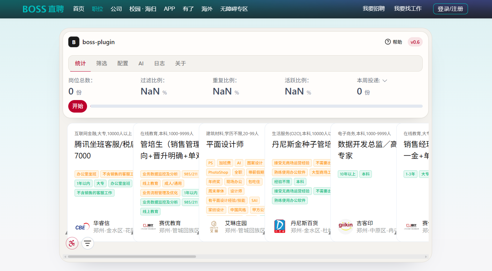
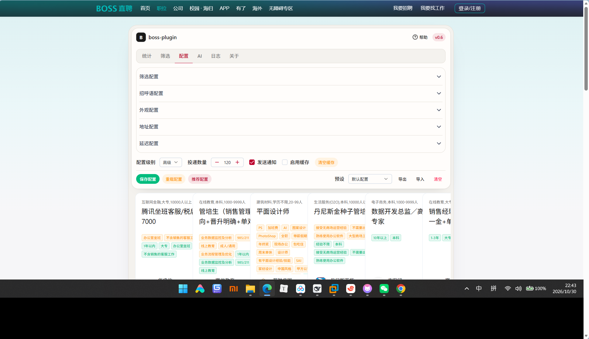
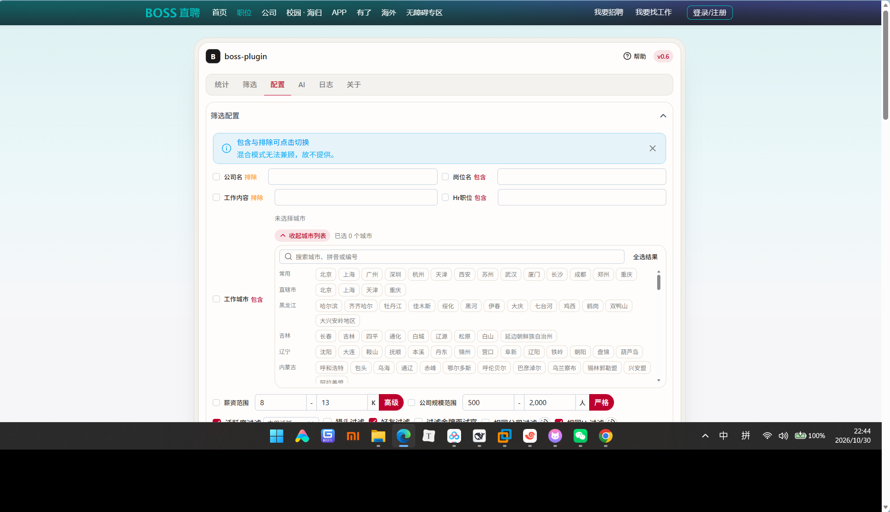
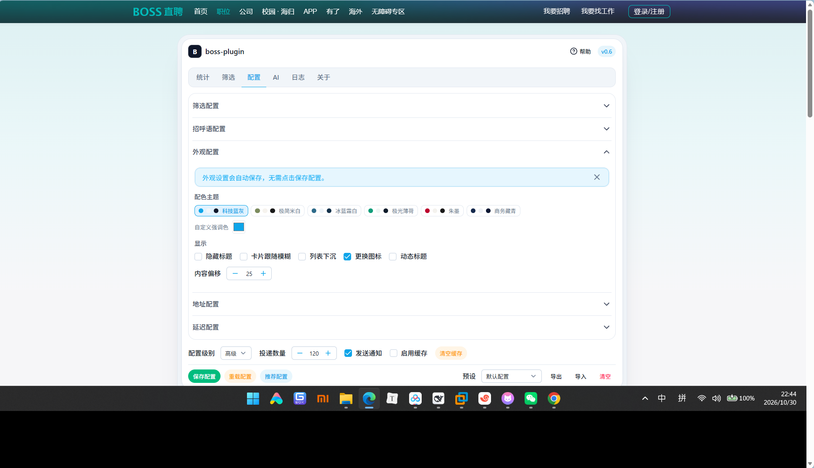
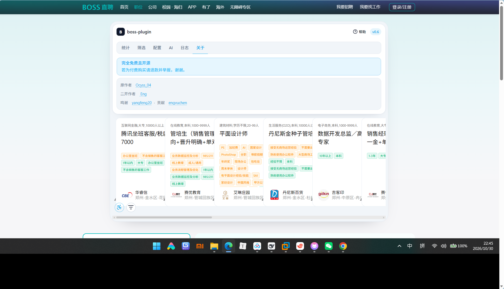
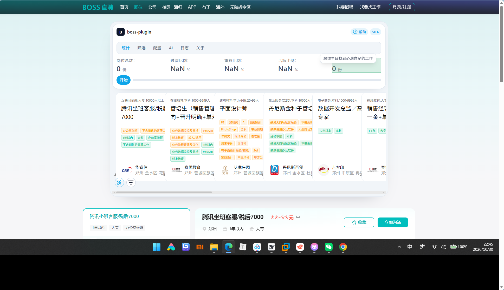

> 本项目仅供学习交流，禁止用于商业用途
> 
>使用该脚本有一定风险(如黑号,封号,权重降低等)，本项目不承担任何责任

> **国内**: 如果无法访问 `Chrome插件商店` , 请使用 `Crx搜搜` 或 `Edge插件商店` 安装

## 项目介绍

Boss直聘助手, 皆在减少投递简历的麻烦, 和提高投递简历的效率, 技术栈使用WXT + Vue3 + NuxtUI@4 + TailwindCSS@4, 开源在 Github 欢迎前来Pr

> 基于原作者进行二次开发

## 相关链接

原作者唯一交流群:
微信麻烦, 飞书人数限制, 所以只开tg一个~

Github开源地址: <https://github.com/ocyss/boss-helper>

## 项目预览

> 新增功能

- [x] 优化UI
- [x] 批量投递简历
- [x] 增加城市选择
- [x] 外观颜色

## 参与贡献

1. Fork 本仓库并克隆到本地。
2. 在新分支上进行您的更改：`git checkout -b 您的分支名称`
3. 提交更改：`git commit -am '描述您的更改'`
4. 推送更改到您的 Fork：`git push origin 您的分支名称`
5. 提交 Pull 请求。

## 鸣谢

- <https://github.com/yangfeng20/boss_batch_push>
- <https://github.com/lisonge/vite-plugin-monkey>
- <https://github.com/chatanywhere/GPT_API_free>

- <https://uiverse.io/>
- <https://www.runoob.com/manual/mqtt/protocol/MQTT-3.1.1-CN.pdf>

## 最后

感谢作者开源！功能非常好用
